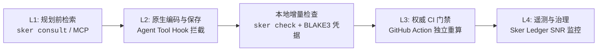

# Sker

> **面向 AI 编码代理（Coding Agents）的负面知识护栏与可审计合规编译器**
> 
> *Offline-first negative knowledge guardrails and auditable compliance compiler for AI coding agents.*

[](https://github.com/ai-timer/sker/actions/workflows/ci.yml)
[](https://github.com/ai-timer/sker/releases)
[](LICENSE)

---

## 📚 文档中心 (Documentation)

| 文档指南 | 适用场景与内容简介 |
| :--- | :--- |
| 🚀 **[快速开始 (Quickstart)](docs/quickstart.md)** | 5 分钟在已有或全新业务仓中接入 Sker 全流程 |
| ✍️ **[规约编写与 Fixtures (Writing Rules)](docs/writing-rules.md)** | AST 语法规则、启发式语义规则、强制测试夹具与防投毒覆盖 |
| 🤖 **[Agent 深度集成 (Agent Integration)](docs/agent-integration.md)** | Codex / Claude Code / Antigravity / Cursor / CodeBuddy 声明式接入、MCP 工具与 Hook 拦截 |
| 🛡️ **[CI 权威重算与审计 (CI & Audit)](docs/ci-and-audit.md)** | GitHub Composite Action、SARIF 报告与人机混合判定模型 |
| 📊 **[Ledger 遥测与治理 (Ledger & Telemetry)](docs/ledger-and-telemetry.md)** | 部署监控大盘、CLI/CI 遥测端到端上报、7 项核心指标与 SNR 噪音率治理 |
| 📖 **[CLI 完整命令参考 (CLI Reference)](docs/cli-reference.md)** | 全部 13 个 CLI 子命令语法、Flags 参数、配置文件 Schema 及退出码速查 |

---

## 什么是 Sker？

在现代软件工程中，AI 编码代理极大提升了开发速度，但往往缺乏项目特有的上下文，频繁违反团队沉淀的架构红线、反复踩入历史故障深坑。传统的 Prompt 堆砌不仅容易引发模型遗忘，更在规则库扩大时导致上下文窗口爆炸。

**Sker** 将团队积累的“负面知识”（*What NOT to do*）编译为机器可执行、离线优先的规则包，通过分层护栏设计保证规则库在增至 500+ 条时仍维持 **$O(1)$ 的代理常驻上下文成本**，并对每一次代码合并提供不可抵赖的密码学凭据审计。



- **纯 Rust 零 C 依赖**：无 `openssl-sys`、无 `libgit2`，跨 macOS、Linux 与 Windows 原生秒级运行；
- **离线优先 (Offline-First)**：本地编译、语法分析与检索全程离线，零外部网络依赖；
- **存量债务安全基线 (Baseline)**：采用语法 AST 节点与规范化片段锚定，行号位移不失效；
- **绝对权威中心**：CI 独立检出全量重算，拒绝盲信本地声明，支持双人签批防规则投毒。

---

## 快速安装

### 方式一：官方一键安装（推荐，macOS & Linux）
```bash
curl --proto '=https' --tlsv1.2 -LsSf https://github.com/ai-timer/sker/releases/download/v0.1.0-preview/sker-cli-installer.sh | sh
```

### 方式二：Homebrew (macOS)
```bash
brew install ai-timer/tap/sker
```

---

## 5 分钟上手体验

```bash
# 1. 在项目根目录初始化 Sker 规约与 Agent 指导（自动生成 .sker.yaml、引导块与初始 bundle）
sker init

# 2. 检查开发环境就绪状态
sker doctor

# 3. 冻结存量代码债务（后续日常检查仅关注 Git 增量 diff）
sker baseline freeze

# 4. 执行本地增量检查（毫秒级输出，扫描工作区全部新增/修改行）
sker check

# 5. Agent 规划前检索相关防踩坑提示
sker consult "use raw sql query" src/db/

# 6. 按需启用更多 Agent 集成（claude / codex / cursor / codebuddy / windsurf / opencode ...）
sker agent list
sker agent add codebuddy
```

---

## CI 门禁集成 (GitHub Action)

在项目 `.github/workflows/sker.yml` 中添加一行官方 Action 即可完成权威阻断与 PR 合规矩阵渲染：

```yaml
name: Sker Governance Gate

on:
  pull_request:
    branches: [main]

permissions:
  contents: read
  pull-requests: write   # 渲染 PR 幂等合规矩阵评论
  issues: write          # PR 评论 API 支持
  security-events: write # 上传 SARIF 报告到 GitHub Security

jobs:
  sker-check:
    runs-on: ubuntu-latest
    steps:
      - name: Checkout repository
        uses: actions/checkout@v4
        with:
          fetch-depth: 0 # 拉取完整 Git 历史

      - name: Run Sker CI Check
        uses: ai-timer/sker/action@v0.1.0-preview
        with:
          sker-path: sker
          sarif-file: sker-results.sarif
          report-file: sker-check-report.json
          protected-agent-label: agent-authored
```

---

## 开发者与源码构建

```bash
# 克隆仓库
git clone https://github.com/ai-timer/sker.git
cd sker

# 安装 Rust 编译产物
cargo install --path crates/sker-cli

# 运行全套本地测试
cargo test --workspace
```

详细参与规范请参阅 **[CONTRIBUTING.md](CONTRIBUTING.md)**。

---

## 许可证

本项目基于 [Apache License 2.0](LICENSE) 协议开源。
