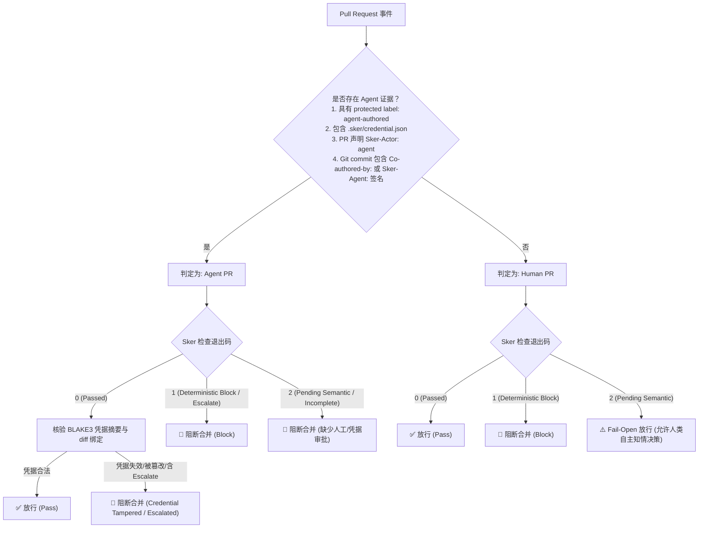

# CI 权威重算与人机混合审计体系 (CI & Audit)

在现代团队中，代码的提交者既可能是人类工程师，也可能是由 AI 代理全自动或半自动生成的 Pull Request。Sker 通过一套**权威 CI 独立重算体系**与**人机混合判定模型**，兼顾日常开发效率与企业安全红线。

---

## 1. 核心安全哲学：CI 是唯一权威中心

- **L1/L2（本地检索与 Hook）是不受信任的效率层**：本地代码、Git 树与凭据均可能由恶意脚本伪造或绕过。
- **L3（GitHub Action）是不可逾越的权威门禁**：
  - CI 绝不读取或信任开发者本地上传的扫描结论；
  - CI 检出代码后，由官方 Action 使用隔离的 `sker` 引擎**重新计算 Git diff**，并使用主分支权威规约包**独立执行全量 AST 分析**；
  - 本地上传的 `.sker/credential.json` 仅作为“供审证据”，必须通过密码学哈希比对。

---

## 2. GitHub Composite Action 接入

在业务仓创建 `.github/workflows/sker-governance.yml`：

```yaml
name: Sker Governance Gate

on:
  pull_request:
    branches: [main, master]

permissions:
  contents: read
  pull-requests: write   # 渲染幂等合规矩阵评论
  issues: write          # PR 评论 API 支持
  security-events: write # 上传 SARIF 报告到 GitHub Security

jobs:
  sker-gate:
    runs-on: ubuntu-latest
    steps:
      - name: Checkout repository
        uses: actions/checkout@v4
        with:
          fetch-depth: 0 # 必须拉取完整历史以提取精确 diff

      - name: Run Sker PR Governance Action
        uses: ai-timer/sker/action@v0.1.0-preview
        with:
          sker-path: sker
          sarif-file: sker-results.sarif
          report-file: sker-check-report.json
          protected-agent-label: agent-authored
          # 可选：配置 Ledger 遥测上报
          # ledger-url: ${{ secrets.SKER_LEDGER_URL }}
          # ledger-token: ${{ secrets.SKER_LEDGER_TOKEN }}
```

---

## 3. 人机混合 PR 判定模型

Action 内部脚本（`classify-pr.sh` 与 `verify-pr.sh`）会自动判定当前 Pull Request 的角色类型：



### 退出码裁决矩阵

| 检查退出码 | 含义 | Human PR 裁决 | Agent PR 裁决 |
| :---: | :--- | :---: | :---: |
| **0** | **Passed**：无违规或全部合规 | ✅ 放行 | ✅ 校验凭据哈希一致后放行 |
| **1** | **Blocked**：命中硬性确定性 `BLOCK` 规则 | 🛑 **阻断** | 🛑 **阻断** |
| **2** | **Incomplete**：命中高危语义待确认项 | ⚠️ **Fail-Open 放行** | 🛑 **阻断**（必须附带明确凭据声明） |

> **设计理由**：人类工程师具备工程常识和自担风险能力，遇到软性建议时不阻断日常敏捷合并；而 AI 代理缺乏最终责任主体，必须通过 `sker attest` 显式确认语义合规或由安全人员介入。

---

## 4. SARIF 报告与 GitHub Code Scanning 集成

Action 运行时会自动调用：
```bash
sker check --ci --sarif sker-results.sarif --json sker-check-report.json
```

若开启了 GitHub Advanced Security，生成的 `sker-results.sarif` 将直接展示在 GitHub PR 的 **Files changed** 审查界面及仓库 **Security → Code scanning alerts** 中，精确高亮违规行号与替代方案。

---

## 5. 幂等 PR 合规矩阵评论与自查卡片

Action 会在 PR 下方自动发表或更新带有 `<!-- sker-compliance-matrix -->` 标记的评论：
- **执行结果总览**：检查状态、变更代码行数、耗时；
- **命中规则列表**：规则 ID、严重等级、代码位置及推荐方案；
- **高危语义自查卡片**：列出触发了 `code_signals` 的敏感行片段，供 Reviewer 重点审查。
- **幂等更新**：后续多次 push 不会反复刷屏，而是就地更新已有评论内容。
